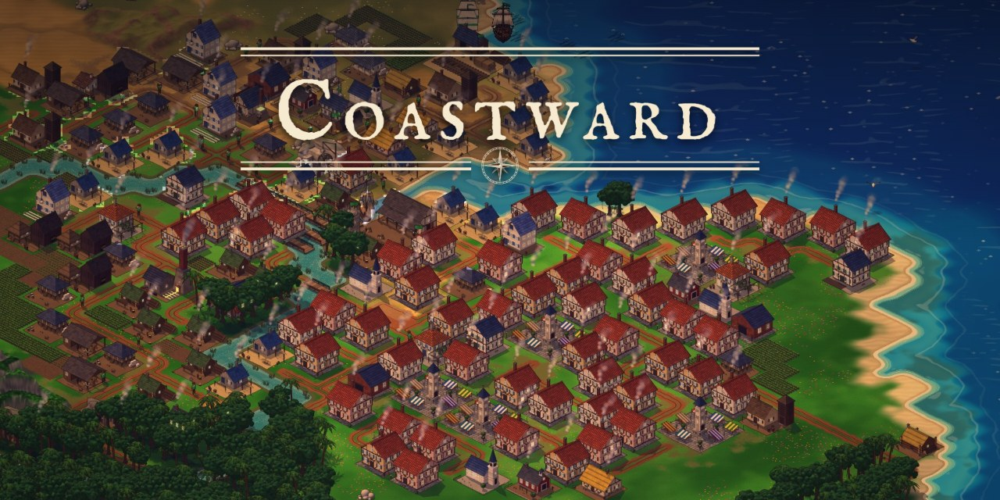

# Coastward



**A cozy pixel-art colony builder.** Sail to a new land, found a settlement and grow it from
a handful of wooden huts into a thriving town: produce goods, keep your people happy, trade
by sea and defend your coast. Play alone against computer opponents or with friends online.

> 🧪 **This is a playtest version.** Expect bugs and rough edges, and please tell us about
> them! Saves may not carry over to every future version.

**[⬇ Download the latest version](../../releases/latest)** &nbsp;·&nbsp;
**[▶ Play in the browser](https://coastward.vercel.app)** (nothing to install) &nbsp;·&nbsp;
**[💬 Discord](https://discord.gg/gaDFAjnrgX)**

---

## What's in the game

- **A new world every game:** generated continents, rivers, mountains and climates, with
  fog of war to explore
- **Build and grow:** about 40 buildings, production chains from wood and fish to cloth, rum
  and jewellery, and houses that move up through the tiers as their needs are met
- **Ships and trade:** trade routes between your settlements, a free trader to buy from
  and sell to, villages inland linked by roads and rivers
- **Military:** soldiers, cavalry, siege engines, warships, walls and towers. Defend
  against pirates or conquer rival towns
- **Computer opponents** with their own personalities: builders, traders and warlords
- **Multiplayer:** accounts, friends, lobbies, chat, diplomacy and trade between players
- **Difficulty from 1 (relaxed) to 5 (brutal)**, or set every option yourself
- **Optional tutorial** for your first game, and an English, German and Czech version
- **Comfort features:** undo, drag-building, blueprints, statistics and graphs,
  colour-blind modes, UI scaling and rebindable keys

## Download & install

Get the files from the **[latest release](../../releases/latest)** (under "Assets").

### 🪟 Windows (10 and 11)

1. Download **`Coastward-Setup-<version>.exe`** and run it.
2. Windows will probably show **"Windows protected your PC"**. The game isn't signed with
   a paid certificate yet, so Windows doesn't know it. Click **More info → Run anyway**.
3. Follow the installer. Coastward then appears in the Start menu.

No installing wanted? Use **`Coastward-<version>-portable.exe`**, which runs directly.

**Updating:** run the new setup; your saves stay.
**Uninstalling:** "Uninstall Coastward" in the Start menu (or Windows Settings → Apps). It
asks whether to delete your saves and settings too.

### 🐧 Linux (64-bit)

1. Download **`Coastward-<version>-linux-x64.tar.gz`**.
2. Unpack it and start the game:
   ```bash
   tar -xzf Coastward-*-linux-x64.tar.gz
   cd Coastward-*/
   ./start.sh
   ```
3. Optional: `./install.sh` adds Coastward to your application menu
   (`./install.sh --remove` takes it out again).

Saves and settings are kept in `~/.config/Coastward`.

### 🤖 Android (6.0 and newer)

1. Download **`Coastward-<version>.apk`** on your phone or tablet.
2. Open it. Android asks to allow installing apps from your browser or file manager: allow
   it (just for this), then tap **Install**.
3. To update, install the newer APK over the old one; your saves stay.

Touch controls: tap to select, drag to scroll, pinch to zoom, hold for orders, two-finger
tap to cancel. Landscape works best.

### 🌐 Browser

**[Play here](https://coastward.vercel.app)** on any modern browser (Chrome,
Firefox, Edge, Safari), on desktop or phone. You can also install it to your home screen
from the browser menu.

## Multiplayer

All versions (Windows, Linux, Android and browser) play together. Click **Multiplayer**
in the main menu, create an account and either join a public lobby, enter a lobby code or
invite a friend.

## Feedback & bug reports

Please report bugs and ideas in our **[Discord](https://discord.gg/gaDFAjnrgX)** (or open an
[issue](../../issues) here). Helpful to include:

- what you were doing and what went wrong,
- your platform (Windows / Linux / Android / browser) and the game version (shown in the
  main menu),
- a screenshot if you can. On desktop, `Ctrl+Shift+I` opens the developer console, where
  red error messages are especially useful.

## Is it safe?

Yes. The warnings come from the game being new and not (yet) signed with a paid
certificate, not from anything it does. It only reads and writes its own saves and
settings, and connects to the Coastward server only for multiplayer. If your antivirus
complains, you can always play the [browser version](https://coastward.vercel.app)
instead.

## License

© 2026 Coastward. All rights reserved. You're welcome to download and play the game for
free. Please don't re-upload, sell or modify it. See [LICENSE](license).

The game uses open-source software (Electron, Chromium, PixiJS and others); their licenses
are included with the game files.
